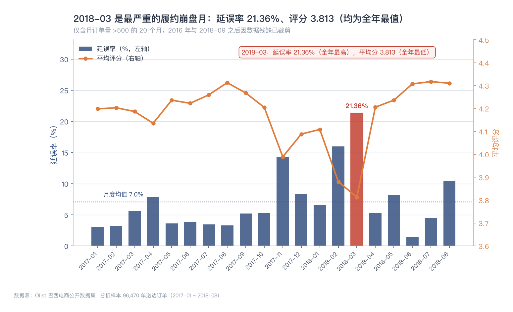
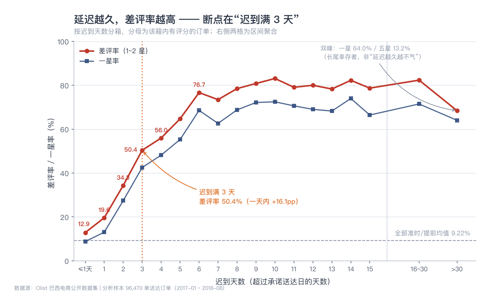
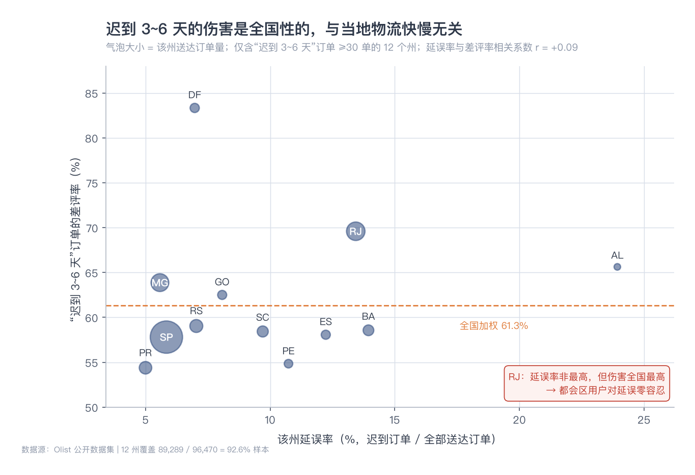
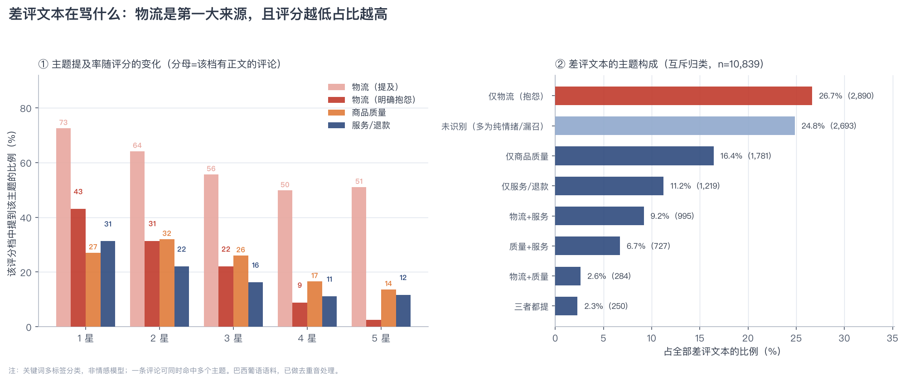
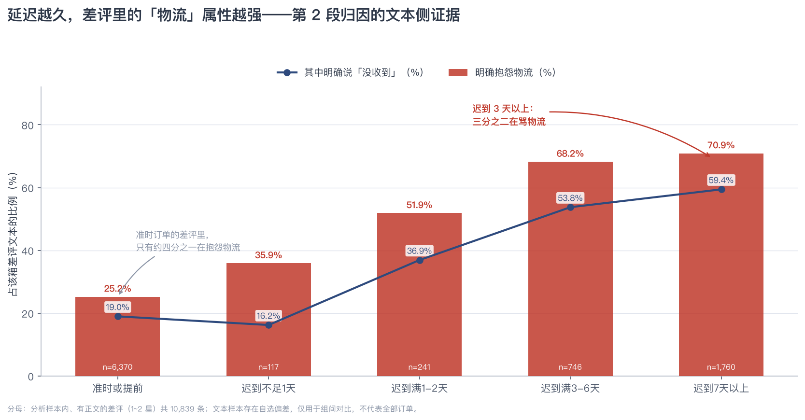
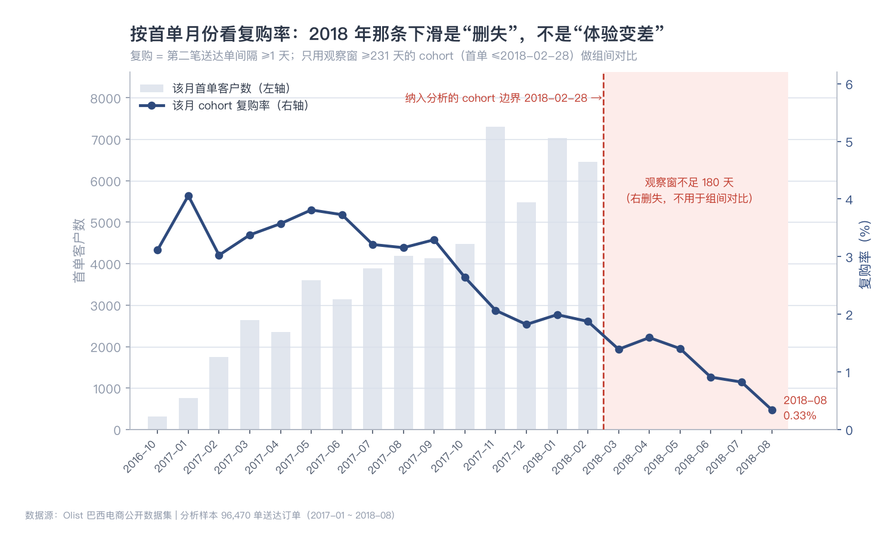
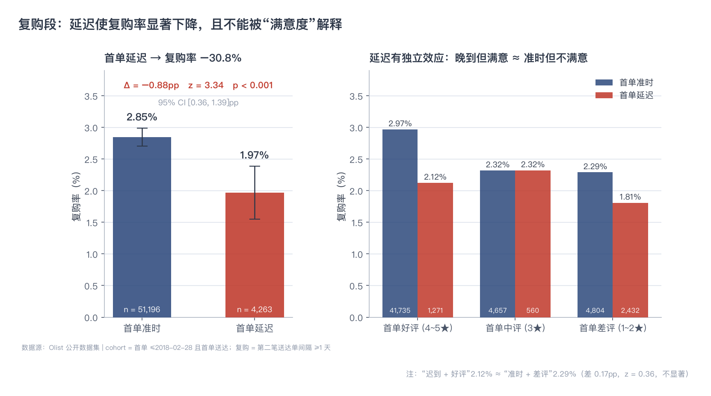

# 物流延迟如何伤害用户：Olist 巴西电商履约体验分析

**数据**：Olist Brazilian E-Commerce Public Dataset（99,441 笔订单 / 9 张表 / 2016-09 ~ 2018-10）
**分析样本**：96,470 笔已送达订单 ｜ **分析窗口**：2017-01 ~ 2018-08 ｜ **工具**：MySQL 8 + Python(matplotlib)
**作者**：陈叶 ｜ **日期**：2026-11 ｜ **口径来源**：`report/metrics_registry.md`（本报告每个数字均可回溯到该表）

---

## 摘要

**一句话结论**：物流延迟对用户满意度的伤害是非线性的——**迟到 1 天用户几乎无感，迟到满 3 天差评率从 34.3% 跃至 50.4%（一天之内跨过"一半用户差评"的线），超过 7 天则稳定在 70%~85% 的平台期**；这个 3 天断点在 20 个月份、12 个样本充足州（覆盖 92.6% 样本）上均成立，与当地物流快慢无关，是心理阈值而非运力问题。

七条主要发现：

1. **基线**：96,470 笔送达订单，GMV 1,542 万元（BRL），AOV 159.85，运费率 16.63%，平均送达 12.54 天（P90 23.08 天），延误率 8.11%，平均评分 4.156，差评率 12.81%。
2. **断点在"迟到满 3 天"**：12.88%（迟到不足 1 天）→ 34.33%（满 2 天）→ **50.40%（满 3 天）**，一星率同期从 27.4% 跳到 42.5%。迟到 1 天只比准时高 1.8pp，不构成"违约感"。
3. **8.06% 的迟到订单贡献了 33.7% 的差评**：迟到订单差评率 54.43%，非迟到 9.22%，**相对风险 5.9 倍**。
4. **断点与物流基础设施无关**：各州平均送达时长相差 2.8 倍（SP 8.7 天 vs AL 24.5 天），但"迟到 3~6 天"的差评率只从 54.4% 变到 83.3%，且与延误率**相关系数仅 r = +0.09**。
5. **文本侧证实"差评确实在骂物流"**：40,774 条葡语正文中，差评里 **40.77% 在抱怨物流、28.07% 提到商品质量**；且"抱怨物流"的比例从准时订单的 **25.24%** 升到迟到 7 天以上的 **70.91%**，同期"提商品质量"从 43.85% 塌到 **1.93%**——若延迟只是伪相关，这一项不该下降 23 倍。
6. **首单延迟显著降低复购**：2.85% → 1.97%（相对 −30.8%，z = 3.34，p ≈ 0.0008）。且"迟到但好评"（2.12%）≈"准时但差评"（2.29%）——**延迟有独立于满意度的效应，道歉与补偿救不回复购**。
7. **但业务杠杆有限**：迟到订单仅占 8.06%，即便完全消除延误，cohort 内整体复购率也只从 2.78% 升到 2.85%（+0.07pp）。**统计显著 ≠ 业务重要**。

**给业务的一句话**：把补偿与主动沟通的触发线从"超过承诺日"改到**"迟到满 3 天"**，并把资源优先投给"延误量大"的州（提时效）与 RJ（提容忍度）两类不同问题。

---

## 1. 业务问题

巴西电商平台 Olist 的差评与低复购，是否能归因于物流延迟？如果是，**延迟几天是临界点**？平台应该优先改善哪类订单的履约？

拆成三个可检验的子问题，构成一条完整因果链：

| 段 | 问题 | 若无法回答，会怎样 |
|---|---|---|
| 1. 基线 | 平台履约与满意度处于什么水平？ | 后面所有"变好/变坏"都失去参照 |
| 2. 归因 | 延迟与差评是线性还是非线性？拐点在哪？ | 只能给出"延迟不好"这种正确但无用的结论 |
| 3. 后果 | 延迟、差评是否影响复购？影响多大？ | 无法判断该不该在物流上投钱 |

**为什么强调"拐点"**：线性结论（"延迟 1 天涨 x pp"）无法指导排期与预算——补偿预算往哪一档投、投诉预警设在第几天，都需要一个**阈值**。本报告的核心产出就是这个阈值及其稳健性。

---

## 2. 数据与口径

### 2.1 数据规模

| 项 | 值 |
|---|---|
| 原始订单 / 商品行 / 客户 | 99,441 / 112,650 / 96,096 |
| 关联表 | 9 张（orders、order_items、order_payments、order_reviews、customers、sellers、products、geolocation、category_translation）|
| 数据时间范围 | 2016-09-04 ~ 2018-10-17 |
| 送达分析样本 | 96,470（`order_status='delivered'` 且有送达时间）|
| 窗口裁剪 | 基线指标用全部 96,470 单；**月度趋势与 cohort 分析裁剪到 2017-01 ~ 2018-08**（2016 年三个月合计约 300 单、2018-09 后数据残缺）|

数据质量问题共 **19 项**，详见 [`data_quality_audit.md`](data_quality_audit.md)。其中四处直接影响结论，必须在建模前处理：

| 问题 | 表现 | 处置 |
|---|---|---|
| `review_id` 不唯一（814 行）| 直接 JOIN 会使订单-评价变成 1:N | 用窗口函数按 `review_answer_timestamp` 取**最新一条**（93 单有多条不一致评价）|
| geolocation 一邮编多坐标（52.6 行/邮编）| 邮编级 JOIN 使订单量膨胀 1.14 倍 | 按邮编聚合（AVG 坐标 / MIN 城市州），并剔除 42 行境外坐标 |
| `customers.customer_id` 与订单 1:1 | 用它算"复购"得到 0%，是伪结论 | 复购必须用 `customer_unique_id`（96,096 人）|
| 评论文本覆盖率仅 41.32%，且与评分强相关 | 直接统计文本会得到"整体差评 70% 是物流"的错误结论 | 只做组间对比；判送达用 `order_delivered_customer_date`，不用文本 |

### 2.2 三个口径决策（本报告全部结论都建立在此之上）

**① 延误率有两个值，8.11% 与 8.06%，都对。**
`is_late` 用秒级比较（`delivered_ts > estimated_ts`），得 8.11%，用于**描述**延误率；`delay_days` 是保留两位小数的天数，迟到不足 7.2 分钟的单被四舍五入成 0，得 8.06%，用于**分箱归因**。差 0.05pp（约 51 单）。**报告正文描述用 8.11%，分箱表内用 8.06%，不混用。**

**② 复购率是 2.05%，不是 3.00%。**
宽松定义（≥2 笔送达单）得 2.91%，但其中 **853 对（30.5%）的第二单与首单在同一天**——那是一次购物车被拆成多单或支付失败重试，不是复购。加 `gap ≥ 1 天` 约束后为 **2.05%（1,967 / 96,096）**。这个修正把延迟对复购的效应从 −0.80pp **放大**到 −0.88pp：错误的定义会**稀释**真实效应，不是随机加噪。

**③ 观察窗截断到 180 天，cohort 截至 2018-02-28。**
82.9% 的复购发生在 180 天内。若不截断，2018 年下单的客户因"没时间复购"被计为未复购（右删失），而这个假象恰好会和 2018 年的高延误率混在一起。截断后样本 55,459 人（57.7%），代价是样本量减少，收益是**组间可比**。

### 2.3 数据建模

| 派生表 | 规模 | 用途 |
|---|---|---|
| `order_level` | 99,441 × 20（3 索引）| 订单级宽表，先 `GROUP BY order_id` 再 JOIN，规避 1.142×/1.006× 双膨胀 |
| `customer_level` | 96,096 × 15 | 客户级底表，含首单体验、复购标志、cohort 标记 |

表结构与字段含义见 [`data_dictionary.md`](data_dictionary.md)，ER 关系见 [`er_diagram.md`](er_diagram.md)。

---

## 3. 方法

### 3.1 五段式分析链路

| 阶段 | 方法 | 关键设计 |
|---|---|---|
| 1. 基线 | 描述统计 | 所有比率的分子分母在同一 SQL 内给出，避免"分母错觉" |
| 2. 归因 | 分箱 + 逐日曲线 + 三重稳健性检验 | 用 `delay_days` 分箱；以 `SUM(条件)` 独立算总量作锚点校验 |
| 3. 文本验证 | 葡语关键词多标签分类（40,774 条正文）| 先量自选偏差再做组间对比；只做"是否提及"不做情感打分 |
| 4. 后果 | cohort 分析 + 两比例 z 检验 | 先算 MDE 再决定能切几层 |
| 5. 结论 | 数字对账 | 全部指标登记在册，跨表交叉验算（如四格表加权须回到主表）|

### 3.2 为什么先算 MDE 再分析

复购率只有 2.05%（cohort 内 2.78%），意味着任何切分都在与噪音搏斗。分析前先算**最小可检测差异**（α=0.05，power=80%，`MDE = 2.8 × SE`；SE 用合并比例计算，故取 cohort 内 2.78%）：

| 方案 | 暴露组 n | 对照组 n | SE | MDE | 相对基线 |
|---|---|---|---:|---:|---:|
| **全国二分（迟到 vs 准时）** | 4,263 | 51,196 | 0.262pp | **0.73pp** | **26%** |
| 按州分 5 组 | ~850 | ~10,200 | 0.586pp | 1.64pp | 59% |
| 按品类分 5 组 | ~850 | ~10,200 | 0.586pp | 1.64pp | 59% |
| 按评分二分（差评 vs 好评）| 7,236 | 43,006 | 0.209pp | 0.58pp | 21% |

（pooled p = 2.78%，`MDE = 2.8 × SE`，与主结果表同源）

结论：**只做"是否延迟""是否差评"的二分对比**，放弃州 × 体验、品类 × 体验的交叉。切到五层后 MDE 从 0.73pp 涨到 1.64pp（相对 26% → 59%），而真实效应大概率在 10%~30% 量级——**会得到一堆"不显著"并被误读成"无影响"**。

> **方法论要点**：报告里"未检出显著差异"必须翻译成"效应小于可检测下限"，而不是"没有影响"。这是本报告主动声明能力边界、而非掩盖阴性结果的做法。

---

## 4. 发现一：基线——一个"整体健康、局部溃烂"的平台

| 指标 | 值 | 说明 |
|---|---:|---|
| GMV（分析样本）| 15,421,082.85 BRL | 96,470 单 |
| AOV | 159.85 BRL | |
| 运费率（运费/商品额）| 16.63% | 运费是消费者决策的显性成本 |
| 平均送达 / P90 | 12.54 天 / 23.08 天 | 长尾明显 |
| 平均提前天数 | 11.16 天 | 承诺期给得极宽松 |
| 延误率 | 8.11% | 秒级口径 |
| 平均评分 | 4.156 | |
| 差评率（≤2 星）| 12.81% | 12,272 / 95,823 |
| 评价覆盖率 | 99.33% | 647 单送达无评价 |

**评分分布**：1★ 9.76%、2★ 3.05%、3★ 8.26%、4★ 19.71%、5★ 59.22%。**一星比二星多 3 倍**——不满是"断崖式表达"，不是渐进式降级。这直接提示：延迟不会让用户"少给一颗星"，而会让用户"直接给一星"。后文的 3 天断点正是这一分布形态的成因。

### 2018-03：最严重的一次履约崩盘


*图 1｜20 个完整月份的延误率（柱）与平均评分（线），2018-03 延误率 21.36% 为全年最高，评分 3.813 为全年最低。*

2018-03 延误率 **21.36%**（月均 7.0% 的 3 倍），评分跌至 **3.813**；2018-04 立刻恢复到 5.31% / 4.206。这是一次典型的**大促后履约崩溃**（2017-11 黑五的订单在 2018 年初集中爆量）。相邻的 2018-02 也偏高（15.99% / 3.881）——崩盘持续了两个月，但 3 月是谷底。

这个月后面会被用两次：作为"结论不是某个月偶然"的反证（第 5.4 节），以及提醒分析时必须排除它的系统性影响（cohort 截断到 2018-02）。

---

## 5. 发现二：归因——延迟的伤害是非线性的，断点在 3 天

### 5.1 主结果：一条由三段组成的曲线


*图 2｜按迟到天数分箱的差评率与一星率。横轴 0 = 迟到不足 1 天，右侧两格为区间聚合。*

| 迟到程度 | 订单数 | 差评率 | 一星率 | 相对上一档 |
|---|---:|---:|---:|---:|
| 提前 8~15 天 | 36,881 | 8.71% | 6.22% | — |
| 提前 3~8 天 | 17,426 | 9.87% | 6.84% | +1.16 |
| **准时及提前 3 天内** | 4,796 | **11.12%** | 7.88% | +1.25 |
| 迟到不足 1 天 | 1,239 | 12.88% | 8.80% | +1.77 |
| 迟到满 1 天 | 825 | 19.63% | 13.05% | +6.75 |
| 迟到满 2 天 | 545 | 34.33% | 27.43% | +14.70 |
| **迟到满 3 天** | **500** | **50.40%** | **42.54%** | **+16.07** |
| 迟到满 4 天 | 453 | 55.96% | 48.17% | +5.56 |
| 迟到满 5 天 | 447 | 64.75% | 55.30% | +8.79 |
| 迟到满 6 天 | 419 | 76.66% | 68.55% | +11.91 |
| 迟到满 7 天 | 483 | 73.46% | 62.63% | −3.20（噪音）|
| 迟到满 8~14 天 | 1,478 | 78.3%~83.1% | 68.3%~74.0% | 平台 |
| 迟到满 15 天 | 159 | 78.71% | 66.45% | 平台 |
| 迟到 16~30 天 | 866 | 82.34% | 71.48% | 峰值 |
| 迟到 30 天以上 | 359 | 68.42% | 64.04% | 双峰，见 5.5 |

> **样本口径**：有评价的送达订单，剔除「提前 15 天以上」的极端早到，合计约 6.7 万单。`delay_days` = `TIMESTAMPDIFF(HOUR, 承诺日, 送达日) / 24`，分箱为闭开区间（如「迟到满 3 天」= `[3, 4)`）。

三段结构：

- **第一段（准时 ~ 迟到 1 天）：平缓区。** 迟到不足 1 天 12.88%，只比准时高 1.8pp。**延迟 1 天不构成"违约感"**——承诺日精确到日期，用户心理上是"这几天内到都算正常"。
- **第二段（迟到 1~3 天）：陡坡。** 一天一档，14.7pp 与 16.1pp 的跃升。**第 3 天是全程最陡的一格**，一星率从 27.4% 翻到 42.5%，一天之内跨过"一半用户差评"的分界线。
- **第三段（7 天以上）：平台 + 顶格。** 78%~83%，从"迟到满 7 天"到"迟到 16~30 天"再拖二十多天，只涨 8.9pp；对比"迟到 1 天→3 天"两天涨 30.8pp。**边际伤害递减，但伤害已经顶格。**

### 5.2 第一个反直觉发现：压线准时已经在扣分

**准时及提前 3 天内 11.12% vs 提前 8~15 天 8.71%，差 2.4pp。**

这不是噪音——两组样本分别是 4,796 和 36,881 单，标准误 0.45pp 与 0.15pp，**2.4pp 的差异约等于 5 个标准误（z ≈ 5.1）**。含义是：**"没有迟到"并不等于"体验合格"**。用户要的不是"准时"，而是"有缓冲地到"。这直接支撑了一条零边际成本的建议（第 8.3 节）。

### 5.3 第二个反直觉发现：断点与物流基础设施无关


*图 3｜12 个样本充足州的延误率（x）与"迟到 3~6 天"差评率（y），气泡大小 = 订单量。*

各州平均送达时长 **SP 8.7 天 vs AL 24.5 天，相差 2.8 倍**。如果"迟到的愤怒"来自物流体验差，那么物流越慢的州应该越麻木（因为习惯了）。

结果相反：`bad_3_6` 在 12 州落在 **54.4%~83.3%**（均值 62.2%），是**一条窄带**，与延误率的相关系数 **r = +0.09（几乎为零）**。把门槛放宽到"3~6 天延迟 ≥15 单"的州，最低仍有 **47.6%**——**没有任何一个样本充足的州低于 45%**。

> **AL 的用户等 24 天到货，和 SP 的用户等 8.7 天到货，对"再晚 3 天"的愤怒程度几乎一样。**

这条比"3 天断点"本身更有价值：它说明 **3 天是跨地区的心理阈值，不是运力短板**。推论是——**修好物流不会让用户对延期更宽容**，3 天这条线不会随基础设施改善而移动。

### 5.4 稳健性：断点不是某个月、某个州的偶然

**① 逐月（20 个月）**：`bad_3_6` 全部 ≥ 46%，均值 58.48%，最低 46.00%（2018-05），最高 72.73%（2017-04）。剔除样本量过小的 3 个月后，`bad_3_6 / bad_1_2` 的倍数落在 **1.65 ~ 3.97**，**没有一个月低于 1.6 倍**。

这里修正了一个预设：**2018-03 爆仓月不是"最伤人"的月**（67.23%，排第 4）。但它的 `n_3_6` = 354，是全年最高（其他月 50~226）。所以——

> **爆仓期的伤害体现在"量"，不在"单位伤害"**：延误订单从约 80 单/月涨到 354 单/月，每一单的"气人程度"和平时一样。2018-03 评分崩到 3.813 是**分母被灌爆**，不是体验本身更糟。

推论：**大促前要控的是延误单量（提前扩容），不是事后补偿——补偿解决不了"量"。**

**② 分州（27 州）**：在"≥7 天延迟 ≥30 单"的 19 个州里，`bad_ge7` 落在 **63.6%（MT，n=35）~ 89.4%（DF，n=47）**，中位 **77.8%**；六个大样本州 **SP 74.5%、BA 73.5%、MG 77.3%、RS 77.2%、SC 78.3%、RJ 83.6%** 全部落在 73%~84% 的窄带内，**零反例**。"延迟超过一周 ≈ 必然差评"比"3 天断点"更硬，因为它不依赖任何分组阈值。

**③ 准时组基线稳得像常数**：`bad_ontime` 在 20 个月里是 **7.39%~10.69%**（波动 ±1.7pp），各地 8.58%~11.15%。这意味着后续所有归因都可以放心用"准时组"当对照组。

### 5.5 两个异常：一个是真信号，一个是噪音

**① RJ（里约）是唯一的真异常。** 延误率 13.43% 只排第 7、时效中等，但 `bad_3_6` **69.59%** 和 `bad_ge7` **83.58%** 双双全国最高，边际惩罚（`bad_3_6 − bad_ontime`）58.71 也是全场最高。

RJ 不是"物流差"，是**用户对延误零容忍**。它与 BA/ES 是两类问题：
- **BA / ES**：物流慢（19.3 / 15.8 天），3~6 天延迟单占比全样本最高（3.56% / 3.31%）→ **"量"的问题，解法是提时效**；
- **RJ**：量不大（3~6 天延迟单占 2.47%）但每单都更伤人（`bad_3_6` 69.59% vs BA 58.56%）→ **"质"的问题，解法是提容忍度（主动告知 + 延误即补偿）**。

**② 迟到 30 天以上的回落（68.42% < 82.34%）是真实差异，但无法归因。**
359 单，差 13.9pp，z ≈ 4.9，不是抽样噪音。两个可检验机制都被否掉：

| 假说 | 检验 | 结果 | 判定 |
|---|---|---|---|
| 承诺失真（预计送达日给太短）| 两组承诺期长度 | 25.9 天 vs 25.1 天（B 组反而多 0.8 天）| ❌ 否定 |
| 退款挽回（钱退了所以气消）| `price + freight − pay_total` | +0.38 vs −0.02 BRL；不一致率 0.56% vs 0.23%（绝对量 2 单）| ❌ 否定 |

剩下唯一站得住的解释是**自我选择**：B 组平均送达 80.5 天（A 组 46.4 天），能等 80 天不退款、还回来评价的本身就是极端耐心样本。评分呈双峰（64.0% 一星 + 13.1% 五星，A 组五星仅 5.1%）——那 13% 的五星不是"满意"，是"终于到了"的情绪释放。

该群体近半（49.2%）产生于 2017-11（黑五）、2018-02、2018-03 三个履约高压窗口，呈"大促积压长尾"特征。

> 本报告不作"延迟越久伤害越小"的因果解读。**"我试了两个解释、都否了、所以我不断言"比编一个漂亮解释更有价值。**

### 5.6 迟到订单的业务量级

| 指标 | 值 |
|---|---:|
| 迟到订单数 / 占比 | 7,773 / 8.06% |
| 迟到订单差评率 | 54.43% |
| 非迟到订单差评率 | 9.22% |
| 相对风险 | **5.9 倍** |
| 迟到订单贡献差评占比 | **33.74%**（4,141 / 12,272）|

---

## 6. 发现三：文本——差评到底在骂什么

前两段只用 `review_score` 这一个结构化字段，能证明"延迟 → 差评"在数量上成立，但回答不了一个更基础的问题：**给差评的人，是不是真的在骂物流？** 如果一半差评在骂商品质量或客服，那"3 天断点"就只是时间上的巧合。

这一段用 40,774 条葡语评论正文做反向验证。**方法说明**：葡语没有可用的中文/英文情感词典，本项目也没有标注语料，因此不做情感极性打分（那样的分数无法验证），只做**关键词多标签分类**——"是否提到某主题"这种判断可以人工抽检、可以复现。词表与逻辑见 `scripts/review_mining.py`。

### 6.1 先量自选偏差，否则后面所有比例都不可读

只有 **41.32%**（40,774 / 98,672）的评价带正文，而且"写不写"与评分强相关：

| 评分 | 订单数 | 有正文 | 覆盖率 |
|---|---:|---:|---:|
| 1 星 | 11,363 | 8,706 | **76.62%** |
| 2 星 | 3,131 | 2,133 | 68.13% |
| 3 星 | 8,133 | 3,538 | 43.50% |
| 4 星 | 19,038 | 5,949 | 31.25% |
| 5 星 | 57,007 | 20,448 | 35.87% |

有正文组的差评率 **26.58%**，全样本 14.69%——**文本样本的差评率是整体的 1.8 倍**，而且 1 星用户的开口率是 4 星的两倍多。

所以本段结论只在**组间对比**的意义上成立：可以说"迟到订单的差评里，抱怨物流的比例更高"，**不能说"全部差评中 70% 源于物流"**——沉默的那 58% 用户中满意者占多数，这是分母问题，和第 5 段踩过的坑是同一类。

### 6.2 差评在骂什么

先说口径。关键词分两个层次：**"提到物流"**（`LOG`，含"送得快"这类中性甚至正面的提及）与**"抱怨物流"**（`LOGN`，只保留"没收到 / 迟到 / 一直没到"这类负面表述）。差评里"提到物流"高达 **70.90%**，但这个数字**不能**读成"70% 在骂物流"——"Chegou sujo e com a tinta grudenta"（到货但脏）也算"提到"。所以下面的主题构成一律用**窄口径（抱怨）**。


*图 4｜左：各评分档的主题提及率与抱怨率（多标签，可重叠）；右：差评文本的互斥归类（n=10,839）。*

| 差评文本归类（互斥，窄口径） | 条数 | 占比 |
|---|---:|---:|
| **仅物流（抱怨）** | 2,890 | **26.66%** |
| **仅商品质量** | 1,781 | **16.43%** |
| 仅服务/退款 | 1,219 | 11.25% |
| **物流 + 服务** | 995 | 9.18% |
| 质量 + 服务 | 727 | 6.71% |
| 物流 + 质量 | 284 | 2.62% |
| 三者都提 | 250 | 2.31% |
| 未识别（纯情绪表达 / 词典漏召） | 2,693 | 24.85% |

**含"抱怨物流"的差评 40.77%，含商品质量 28.07%——物流是最大的单一类别，约为质量问题的 1.5 倍。** "物流 + 服务"这一档（9.18%）绝大多数是"没收到货 + 客服不回应"的组合：**差评的两大来源是"货没到"和"没人管"，而不是"东西不好"。**

需要提醒的是，未识别占 24.85%（2,693 条），主要是纯情绪表达（"Não deveria ter comprado"、"Achei que o produto fosse melhor"）以及词典漏召。这是关键词法的固有代价：**它只会低估主题份额，不会把某个主题错算给另一个主题**（详见 6.5）。

### 6.3 反向验证：延迟越久，差评越"纯物流"

如果"延迟 → 差评"只是伪相关（真实原因是商品差、而差商品恰好也慢），那么迟到订单的差评里，**商品质量的提及率不应该下降**。实测它下降了 23 倍：


*图 5｜差评文本中"明确抱怨物流"与"明确说没收到"的比例，按延迟分箱。柱内为样本量。*

| 延迟分箱 | 差评文本数 | 抱怨物流 | 明确说"没收到" | 提商品质量 |
|---|---:|---:|---:|---:|
| 准时或提前 | 6,370 | **25.24%** | 19.00% | 43.85% |
| 迟到不足 1 天 | 117 | 35.90% | 16.24% | 33.33% |
| 迟到满 1~2 天 | 241 | 51.87% | 36.93% | 23.65% |
| 迟到满 3~6 天 | 746 | **68.23%** | 53.75% | **6.17%** |
| 迟到 7 天以上 | 1,760 | **70.91%** | 59.43% | **1.93%** |

合并对比：准时 **25.24%** vs 迟到 **67.18%**，差 **+41.94pp**，`z = 38.35`。

三个读法：

1. **物流抱怨率随延迟单调上升**，从四分之一涨到七成——延迟越久，差评越是在说物流这一件事。
2. **商品质量的提及率从 43.85% 塌到 1.93%**（23 倍）。这是最有说服力的一条：订单一旦迟到，用户的注意力完全被"还没到"占据，商品本身好不好已经不重要了。若延迟只是伪相关，这里应当持平而不是塌缩。
3. **"明确说没收到"在迟到 3 天以上超过一半（53.75%~59.43%）**，而准时组只有 19.00%——但准时组这 19% 并非数据错误，见下节。

### 6.4 一个必须披露的口径问题：11.27% 的评价写在送达之前

| 项 | 值 |
|---|---:|
| 可比样本（有正文 + 有送达时间）| 38,902 |
| 评价创建时间早于送达时间 | **4,385（11.27%）** |
| 在"明确说没收到"的 4,270 条中，属于送达前评价 | 1,726（**40.42%**）|

> **读表注意**：本节 4,270 是**全部有正文评价**（40,774，不限评分、不限是否有送达时间）中提到"没收到"的条数；6.3 节"明确说没收到"那一列只统计**差评且有送达时间**的子集（9,234，合计 2,765 条）。两者分母不同，不可直接相减或比较比例。

Olist 的评价问卷在承诺日附近触发，用户可能在下单后若干天就收到邀请并作答。这解释了两件事：

- **送达订单的差评里为什么还有 19.00% 说"没收到"**——评价那一刻确实还没收到，货后来到了；
- **为什么不能用"评价里说没收到"直接推断"最终没送达"**。这也是本报告坚持用 `order_delivered_customer_date` 判送达、而不是用评论文本判送达的原因。

这不削弱"延迟 → 差评"的结论（差评是真实发生的情绪），但说明"未收到"类抱怨反映的是**承诺期内的等待焦虑**，而不是永久丢件——恰恰支持第 5 段"承诺期本身是体验"的结论。

### 6.5 方法局限（必须自己先说）

- **关键词法，非情感模型**。没有标注语料就不报 P/R 曲线；人工抽检 45 条（每类 15 条）：物流抱怨类 2 条存疑（"还在等换货回复"被判成物流、"少发一件"被判成物流），质量类与服务类各 15 条基本无误，**单类准确率 86.7%~100%，整体 43/45 ≈ 95.6%**。
- **未识别占 24.85%**（2,693 条），多为纯情绪表达（"Não deveria ter comprado"、"Achei que o produto fosse melhor"）或词典漏召（"veio uma parte maior do que a outra"）。这部分**不会**系统性偏向某一主题，因此不影响组间对比，但会低估各主题的绝对份额。
- **葡语变体与拼写错误**（"recebir"、"nao" 无重音）已通过词干匹配 + 去重音处理，但仍有漏召。

---

## 7. 发现四：后果——延迟伤复购，且不能被满意度解释

### 7.1 复购率的定义修正（这一步决定了后面所有数字）


*图 6｜按首单月份看复购率。2018 年那条下滑由观察窗不足造成（右侧阴影），不是体验恶化。*

宽口径复购率 2.91%，但拆开间隔发现：**853 对（30.5%）的第二单与首单在同一天**，890 对（31.8%）在 24 小时内。这不是复购，是下单被拆（同一购物车分卖家结算 / 支付重试）。加 `gap ≥ 1 天` 约束后——

**复购率 = 2.05%（1,967 / 96,096）**，这是本报告采用的口径；cohort 内为 2.78%（1,541 / 55,459），用于组间对比。


*图 7｜左：首单准时 vs 延迟的复购率及 95% CI；右：延迟 × 评分六格。*

### 7.2 主结果

| 首单体验 | 人数 | 复购人数 | 复购率 |
|---|---:|---:|---:|
| 准时 | 51,196 | 1,457 | **2.85%** |
| 迟到 | 4,263 | 84 | **1.97%** |

- 绝对差 **−0.88pp**，`SE = 0.262pp`，**z = 3.34，p ≈ 0.0008**
- 95% CI **[0.36, 1.39]pp**，相对降幅 **−30.8%**

**分地区稳健**：SP −0.84pp（3.10%→2.26%）、非 SP −0.80pp（2.67%→1.87%），**两地绝对值只差 0.04pp**。SP 未达显著纯属功效不足（迟到组仅 1,106 人，MDE 1.49pp，而实际差异 0.84pp）。这排除了"效应由偏远地区客户构成差异造成"的替代解释。

### 7.3 关键发现：延迟有独立于满意度的效应

| 首单体验 | 人数 | 复购率 | 相对"准时+好评" |
|---|---:|---:|---:|
| 准时 + 好评 | 41,735 | **2.97%** | 基准 |
| 准时 + 中评 | 4,657 | 2.32% | −0.65 |
| **准时 + 差评** | 4,804 | **2.29%** | −0.68（z=2.66，显著）|
| 迟到 + 中评 | 560 | 2.32% | −0.65 |
| **迟到 + 好评** | 1,271 | **2.12%** | −0.85 |
| 迟到 + 差评 | 2,432 | 1.81% | −1.16 |

**"晚到但满意"（2.12%）与"准时但不满意"（2.29%）统计上无差别（z = 0.36）。**

三句话读法：

1. **延迟的效应（−0.85）比差评的效应（−0.68）更大。** 物流体验比"嘴上骂不骂"更能预测复购。
2. **两者叠加只有 −1.16，小于 −1.53（次可加）**，说明相当一部分是同一件事，但延迟那一份更"硬"。
3. **一旦延迟了，差评就不再额外扣分**（迟到组内 好评 2.12% vs 差评 1.81%，z = 0.65 不显著）；而准时组内差评效应显著。翻译成人话：**用户记的是"这次到底晚没晚"，不是"我给了几星"。**

业务推论很直接：**"让用户满意地延迟"（道歉、补偿、主动告知）救不了复购，得减少延迟本身。** 这与"优质补救能挽回客户"的常见假设相反，但在本数据里非常清楚。

### 7.4 显著 ≠ 重要

迟到订单只占 8.06%。**即使把延误全部消灭，cohort 内整体复购率也只从 2.78% 升到 2.85%（+0.07pp，相对 +2.4%）。**

所以物流时效对复购的定位是：**统计上确凿、业务上杠杆有限**。提升复购必须并重非物流手段。

---

## 8. 建议

### 8.1 把补偿与主动沟通的触发线定在"迟到满 3 天"

**依据**：迟到不足 1 天 12.88%（相对准时 +1.8pp，用户无感），在 1~2 天介入是资源浪费；满 3 天跳到 50.40%（+39.3pp），此时干预的边际收益最高。文本侧同向：差评里抱怨物流的比例在迟到 3~6 天时为 68.23%，其中 53.75% 直接说"还没收到"——**这一档的用户要的不是解释，是"到底到哪了"**。

**落地**：预警系统 T+1 触发（识别风险），T+3 触发动作（补偿券 / 主动致电 / 优先改派）。**动作内容优先给轨迹信息而非话术**：71% 的差评在说物流，其中过半在说"没收到"，主动推送承运商轨迹 + 明确新到达日，比道歉更对症。

### 8.2 资源按"问题类型"分三类投放

| 类型 | 地区 | 数据特征 | 动作 |
|---|---|---|---|
| **量的问题** | BA、ES、AL | 延误率 12.2%~23.9%（AL 最高但仅 397 单）；BA/ES 的 3~6 天延迟单占比全样本最高（3.56% / 3.31%）；平均送达 15.8~24.5 天 | 提时效：换承运商、前置仓、干线优化 |
| **质的问题** | RJ | 延误率 13.4%（全国第 7），但 `bad_3_6` 69.6%、`bad_ge7` 83.6% 双项最高，且 3~6 天延迟单只占 2.47% | 提容忍度：主动告知 + 延误即补偿 + 物流轨迹可视化 |
| **跳档地区** | CE、SE、PE、MA、PA | `n_ge7 / n_3_6` = 2.4~4.4，延误直接跳过 3~6 天档 | 提前预判 + 改派兜底（"3 天内补救"这档无货可救）|

**三类问题不能用同一套 KPI。** 对跳档州考核"3 天内补救率"是无效指标，因为它们的问题不在 3~6 天这一档。

### 8.3 承诺期给 2~3 天缓冲，比压缩实际时效更划算

**依据**：提前 8~15 天到货差评率 8.71%，压线准时（提前 3 天内）11.12%，差 2.4pp。承诺期调整是**零边际成本**的动作，而压缩实际时效要花真金白银。

**注意**：这不等于"故意报慢"。缓冲的作用是让"正常波动不构成违约"，需与实际时效改善配套，否则只是把差评推迟到第 4 天。

### 8.4 大促的抓手是"控量"，不是"补偿"

**依据**：2018-03 延误率 21.36%，`n_3_6` 354 单（全年最高），但 `bad_3_6` 67.23% 只排第 4——**单位伤害没变，是单量暴涨**。

**落地**：大促前扩容与限流（按承运商历史时效分配运力），而不是事后发券。补偿解决不了"量"，只能安抚其中一部分。

### 8.5 复购不要指望物流

延迟对复购的统计效应显著（p ≈ 0.0008），但杠杆不足 0.1pp。提升复购应优先非物流手段（会员体系、复购券、品类交叉），物流侧的投入应该以"降差评、降投诉"为 KPI，而不是"提复购"。

---

## 9. 局限与反思

### 9.1 研究局限

**① 观测性研究，非因果推断。** 未做随机化或匹配，未控制卖家、品类、客单价、促销参与。所有结论均为相关关系。RJ 的异常（伤害最高但延误率仅第 7）说明存在未观测的地区性因素。

**② cohort 截断带来样本损失。** 为保证观察窗一致，截断到首单 ≤ 2018-02-28，样本 55,459（57.7%），并刻意排除了 2018-03 爆仓月——这提升了内部效度，但结论不能直接外推到"爆仓月的新客"。

**③ 小分母限制了可检验的假设。** 复购率 2.05%，MDE 0.73pp（相对 26%）。**"未检出显著"应理解为"效应小于可检测下限"，而非"无影响"。**

**④ 评价存在自选偏差，差评率被低估。** 评价覆盖率随延迟单调下降：准时组 99.5% → 迟到 16~30 天 96.9% → 30 天以上 95.3%。越不满意的用户越可能直接沉默，因此 78%~82% 的差评率是**下限**。

**⑤ 迟到 30 天以上的回落无法归因。** 两个可检验机制均被否定，剩余解释（自我选择 + 情绪极化）无法用本数据验证，故不作因果解读。

**⑥ 文本分析受限于语料与方法。** ①只有 41.32% 的评价带正文，且 1 星用户的开口率是 4 星的两倍（76.62% vs 31.25%），文本样本的差评率是全样本的 1.8 倍，**不能用来推断整体差评的原因构成**；②葡语无标注语料，只能用关键词法做"提及与否"的判断，未识别占 24.85%，各主题的绝对份额被低估；③11.27% 的评价写在送达之前（"说没收到"的样本中占 40.42%），文本里的"未收到"反映的是等待焦虑，不等于永久丢件。

### 9.2 方法论反思（四条可复用的教训）

**① 口径先行，比率必须写明分母。**
本项目出现的三次"预期对不上"，全部源于分母口径：
- 复购率 3.00% / 2.91% / 2.78% / 2.05%（分母分别是 93,350 / 96,096 / 55,459 / 96,096）
- 差评率 12.77% → 12.81%（分母应是 95,823 而非 96,470）
- 延误率 8.11% / 8.06%（`is_late` vs `delay_days`）

解决方式：建立 `metrics_registry.md` 作为唯一口径来源，任何材料取数只能来自该表。

**② 定义决定结论，且方向可预测。**
剔除同日拆单后，延迟对复购的效应从 −0.80pp **放大**到 −0.88pp，z 从 2.57 升到 3.34。原因是迟到组的同日拆单占比更高（39% vs 29%）。**错误的定义通常会稀释真实效应，而不是随机加噪**——这意味着"没做出显著结果"时，第一反应应该是检查定义，而不是宣布无效应。

**③ 分箱必须用无歧义条件 + 独立锚点校验。**
`delay_days <= 15` 导致 (15,16) 的 150 单归错箱，表现为"迟到满 15 天只有 9 单"这种反常识结果。同时 MySQL 的 `1/n` 只保留 4 位小数（`div_precision_increment`），使标准误被低估、z 值虚高（3.78 vs 正确 3.34）。

现在的规矩：**凡是 CASE 多分支分箱，先用 `SUM(条件)` 独立算出各段总量当锚点，对上了再解读。**

**④ 文本分析的第一件事是量"谁开口"，不是数"谁说了什么"。**
41.32% 的正文覆盖率看似够用，但 1 星用户开口率 76.62%、4 星只有 31.25%——**文本样本本身就是被情绪筛选过的**，其差评率（26.58%）是全样本（14.69%）的 1.8 倍。若不先量化这个偏差，任何"差评中 70% 是物流问题"的表述都会被误读成"整体差评中 70% 是物流问题"。正确做法：**只做组间对比，不做总体推断**，并在方法段明写分母。

---

## 附录 A：指标口径速查

| 指标 | 采用值 | 定义 | 易错点 |
|---|---:|---|---|
| 延误率（描述）| 8.11% | `delivered_ts > estimated_ts`（秒级）| 与分箱口径 8.06% 不同，勿混用 |
| 延误率（分箱）| 8.06% | `delay_days > 0` | 两位小数四舍五入导致约 51 单落在 0.00 |
| 差评率 | 12.81% | ≤2 星 / **有评分的订单**（95,823）| 分母不是 96,470 |
| 复购率 | 2.05% | ≥2 笔送达单且间隔 ≥1 天 / 96,096 | 不加间隔约束会虚高至 2.91% |
| 迟到 N 天 | `FLOOR(delay_days) = N` | 即 `[N, N+1)` | 与 `delay_days <= N` 差一档 |
| 运费 | `SUM(freight_value)` | 行级计费，逐件相加 | 非"分摊"，已用 6 条查询验证 |
| 时间间隔 | `TIMESTAMPDIFF(HOUR, …)/24.0` | 满 24 小时 | `DATEDIFF` 是日历日，两者不同 |
| 文本覆盖率 | 41.32% | 正文非空 / 订单级去重评价（40,774 / 98,672）| 分母不是 99,223（原始行数，含重复评价）|
| 物流抱怨率 | 25.24% → 70.91% | 差评文本中命中物流负面词的比例 | 分母是**该箱有正文的差评**，不是全部差评 |

## 附录 B：复现路径

> 文件名按写入顺序编号，下面按**分析段顺序**排列，故 `05` 出现在 `04` 之前。

```
sql/01_build_order_level.sql      建 order_level（99,441 × 20）+ 4 条校验
sql/02_baseline_metrics.sql       第 1 段：基线指标
sql/03_attribution_delay_bins.sql 第 2 段：归因（含分箱锚点查询）
sql/05_review_text_checks.sql     第 3 段：文本分析的 SQL 侧校验（覆盖率/自选偏差/评价时点）
sql/04_repurchase.sql             第 4 段：复购（含 z 检验与 MDE）
scripts/plot_charts.py            正文图 c01~c05（连库取数 + 自校验）
scripts/review_mining.py          文本分类 + 图 c06/c07（--samples 可打印人工抽检样本）
scripts/verify_text_offline.py    文本统计离线复算（只用 data/ 的 CSV，不连库）
```

```bash
pip install -r scripts/requirements.txt
export MYSQL_PWD='你的密码'
python3 scripts/plot_charts.py       # 图 c01~c05
python3 scripts/review_mining.py     # 图 c06~c07 + 六段统计表
python3 scripts/verify_text_offline.py   # 无需数据库，重算第 6 章全部数字
```

## 附录 C：文件索引

| 文件 | 内容 |
|---|---|
| [`data_quality_audit.md`](data_quality_audit.md) | 19 项数据质量问题、处置方式、校验脚本索引 |
| [`er_diagram.md`](er_diagram.md) | 9 张表的实体关系与基数 |
| [`data_dictionary.md`](data_dictionary.md) | 字段字典 + 两张派生表说明 + 字段级陷阱 |
| [`metrics_registry.md`](metrics_registry.md) | 指标口径登记表（唯一口径来源）|
| `images/charts/` | 正文图 c01~c07 |
| `images/qa/`、`images/attr/`、`images/rep/` | 各阶段 SQL 校验截图 |
| [`../scripts/verify_text_offline.py`](../scripts/verify_text_offline.py) | 第 6 章全部数字的离线复算（只用原始 CSV，无需数据库）|

---

*本报告所有数字经 SQL 复算与跨表交叉验算；第 6 章的文本分析另有一条独立验证路径——`scripts/verify_text_offline.py` 绕过 MySQL、直接从原始 CSV 重算，与库内结果逐项一致（唯一差异是 1 单在同一时间戳上被去重到不同评价，见该脚本说明）。图表由 `scripts/plot_charts.py` 与 `scripts/review_mining.py` 从数据库直接生成，非手工绘制。*
