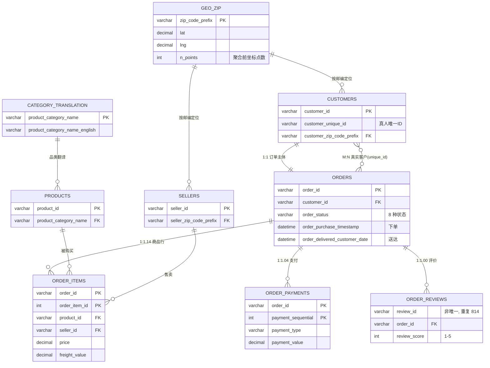

# Olist 数据集 ER 图与表关系说明

## 1. 实体关系图

> `GEO_ZIP` 为派生表：由原始 `geolocation`（1,000,163 行、无主键、52.6 行/邮编）按邮编聚合、并剔除 42 行境外坐标后得到，共 19,010 行。

## 2. 关系清单

| 关系 | 基数 | 关联键 | 实测比值 | 说明 |
|---|---|---|---|---|
| CUSTOMERS → ORDERS | 1:1 | customer_id | 1.000 | 收货人快照，非客户维度 |
| CUSTOMERS → ORDERS | M:N | customer_unique_id | 1.035 | 真实客户维度 |
| ORDERS → ORDER_ITEMS | 1:N | order_id | 1.142 | 一单可多商品/多卖家 |
| ORDERS → ORDER_PAYMENTS | 1:N | order_id | 1.045 | 分期付款产生多笔 |
| ORDERS → ORDER_REVIEWS | 1:N | order_id | 0.998/1.006 | 约 99.8% 订单有评价，约 592 单有多条评价 |
| PRODUCTS → ORDER_ITEMS | 1:N | product_id | 3.419 | 一个商品平均被买几次 |
| SELLERS → ORDER_ITEMS | 1:N | seller_id | 36.397 | 卖家高度集中 |
| CATEGORY_TRANSLATION → PRODUCTS | 1:N | product_category_name | 455.3 | 71 个可译品类覆盖 32,328 商品 |
| GEO_ZIP → CUSTOMERS | 1:N | zip_code_prefix | 5.23 | 匹配率 99.72%（279 条无坐标） |
| GEO_ZIP → SELLERS | 1:N | zip_code_prefix | 0.163 | 匹配率 99.77%（仅 7 条无坐标） |

## 3. 读图结论

1. **粒度**：最小事实粒度是"订单商品行"（order_items，112,650 行，1.142 行/单）。任何订单级指标必须先 `GROUP BY order_id`，否则 `AVG(price)` 算出来是商品行均价而非订单均价。
2. **客户维度**：`customer_id` 与 orders 严格 1:1（实测 1.000），是订单级快照 ID；真人维度必须切换到 `customer_unique_id`（96,096 人，人均 1.035 单），否则复购率被系统性低估 3.4%。
3. **可加性**：`price`/`freight_value` 可 SUM；`review_score` 不可加，只能取均值或分布；`delivery_days` 不可加，须先按订单计算再平均。
4. **地理维度**：唯一入口是派生表 `geolocation_zip`（19,010 行）。客户匹配率 99.72%、卖家 99.77%，地理分析的有效分母分别为 99,162 与 3,088。
5. **长尾**：3,095 个卖家平均承担 36.4 个商品行，销量高度集中，可进一步做帕累托分析（前 N% 卖家贡献 X% 销售额）。

